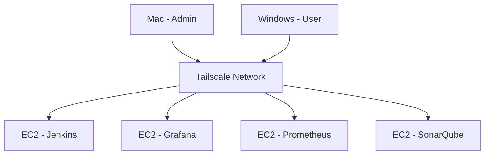
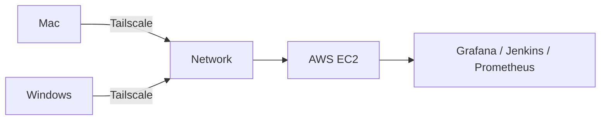

  # 🚀 Tailscale Zero Trust Network with AWS EC2

# Overview: 

      This project demonstrates how to build a **Zero Trust private network** using **Tailscale + AWS EC2**, enabling:

          * 🔐 Secure private infrastructure (No Public IP)
          * 🔑 SSH access without PEM keys
          * 👥 Multi-user access (Mac, Windows, Linux)
          * 🏷️ Tag-based access control (ACL)
          * 🌐 Private application hosting

# Features:

         ✔ Zero Trust Networking
         ✔ Private IP Communication (100.x.x.x)
         ✔ Cross-platform connectivity
         ✔ Role-Based Access Control (RBAC)
         ✔ SSH without key pairs
         ✔ Dockerized application deployment

# Architecture Diagram:

# Network Flow:

# Tech Stack:

         * ☁️ AWS EC2
         * 🔐 Tailscale (WireGuard VPN)
         * 🐳 Docker
         * 🐧 Ubuntu Linux
         * 📊 Grafana & Prometheus
         * 🔧 Jenkins & SonarQube
        

# Setup Guide: 

# STEP:1 Launch EC2 Instance

            * Ubuntu Server
            * t2.micro / t3.micro

   ### Security Group:

            * Allow SSH (temporary)
            * Allow UDP 41641

# STEP:2 Install Docker

            sudo apt update && sudo apt upgrade -y
            sudo apt install docker.io -y
            sudo systemctl start docker
            sudo systemctl enable docker

# STEP:3 Deploy Applications

   ### Grafana
            docker run -d -p 3000:3000 grafana/grafana

   ### Prometheus
            docker run -d -p 9090:9090 prom/prometheus
    
   ### Jenkins
            docker run -d -p 8080:8080 jenkins/jenkins

   ### SonarQube
            docker run -d -p 9000:9000 sonarqube
            

# STEP:4 Install Tailscale:

              curl -fsSL https://tailscale.com/install.sh | sh
              sudo tailscale up --ssh --advertise-tags=tag:server

# STEP:5 Connect Devices:

           * Install Tailscale on Mac/Windows
           * Login using same account or invite users

# ACL Configuration: 

         {
	     "groups": {
		     "group:admins": [
			     "nikildovin.a@dreamstechnologies.com",
			     "sekarshanmugam2003@gmail.com",
		     ],
	     },

	     "tagOwners": {
		     "tag:server": ["group:admins"],
	     },

	     "acls": [
		     {
			     "action": "accept",
			     "src":    ["group:admins"],
			     "dst":    ["*:*"],
		     },
	     ],

	     "ssh": [
		     {
			     "action": "accept",
			     "src":    ["group:admins"],
			     "dst":    ["tag:server"], // ✅ FIXED
			     "users":  ["ubuntu", "root"],
		     },
	     ],

	     "grants": [
		     {
		 	     "src": ["group:admins"],
			     "dst": ["*"],
			     "ip":  ["*"],
		     },
	     ],
     }

# Access Applications:

     | Service    | URL                   |
     | ---------- | --------------------- |
     | Grafana    | http://100.x.x.x:3000 |
     | Prometheus | http://100.x.x.x:9090 |
     | Jenkins    | http://100.x.x.x:8080 |
     | SonarQube  | http://100.x.x.x:9000 |

# SSH Access (No PEM):

        ssh ubuntu@100.x.x.x

# File Transfer:

         scp file.txt user@100.x.x.x:/path
         rsync -avz file user@100.x.x.x:/path

## 🧪 Troubleshooting

| Issue             | Solution          |
| ----------------- | ----------------- |
| SSH timeout       | Start sshd        |
| Permission denied | Check credentials |
| Slow network      | Open UDP 41641    |
| ACL not working   | Update policy     |

---

## 🏆 Achievements

* 🔐 Built Zero Trust Network
* 🌐 Eliminated public exposure
* 👥 Multi-user secure access
* ⚡ High-performance private connectivity
* 🔧 Production-ready DevOps setup

---

## 🚀 Future Enhancements

* Terraform automation
* Kubernetes deployment
* CI/CD pipelines
* Monitoring & logging stack

---

## 📄 Resume Highlight

> Designed and implemented a Zero Trust private network using Tailscale with AWS EC2, enabling secure multi-user access, private application hosting, and SSH without public exposure.

---

## ⭐ Show your support

If you like this project, give it a ⭐ on GitHub!

---
